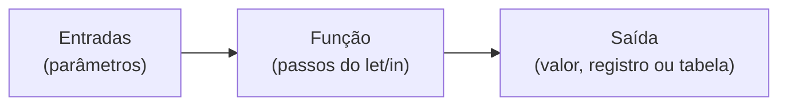
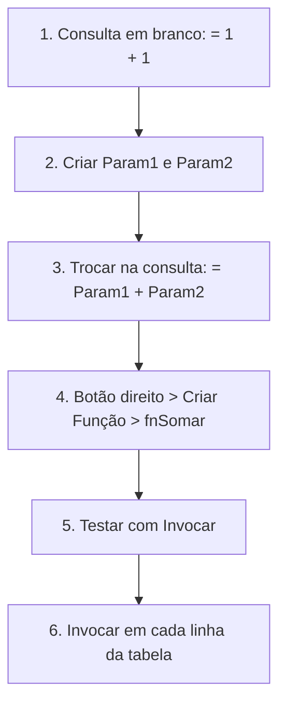
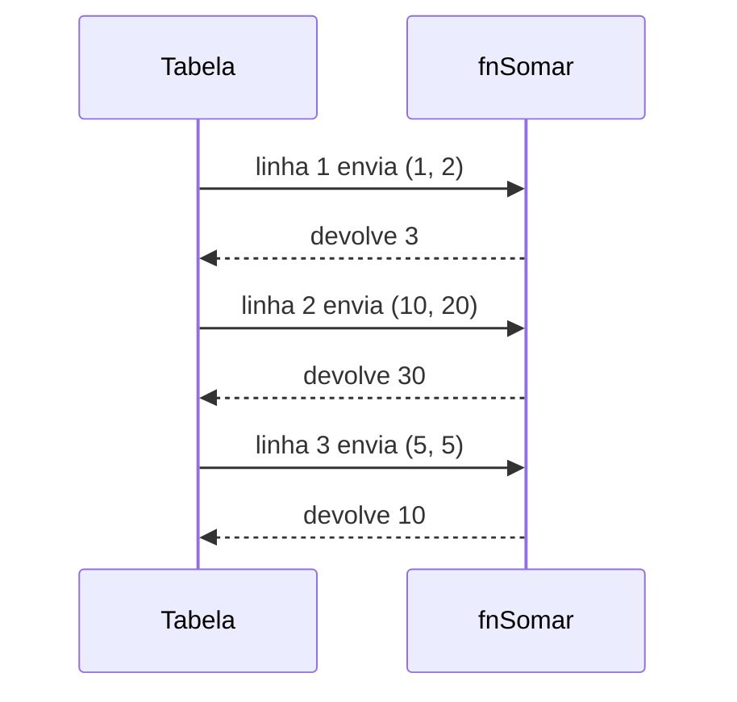

# Funções no Power Query: guia rápido para iniciantes

> Para quem já usa o Power Query no básico (importar, filtrar, transformar colunas) e está descobrindo que existem funções.

## 1. O que é uma função

Uma função é uma **receita com entradas**. Ela recebe valores (parâmetros), executa passos e devolve **um único valor** de saída.

Pense numa máquina de café: entram pó e água, sai café. Você troca o que entra, mas a máquina é sempre a mesma.



## 2. Por que usar funções

- **Reaproveitar:** a mesma lógica serve para várias tabelas e colunas.
- **Corrigir uma vez:** se você ajusta a função, todos os lugares que a usam são atualizados.
- **Repetir linha a linha:** a função roda uma vez para cada linha de uma tabela.

## 3. Vocabulário

| Termo | O que é | Onde aparece |
|---|---|---|
| Consulta | Sequência de passos que devolve um valor ou tabela | Painel Consultas |
| Parâmetro do Power Query | Valor fixo, global, reutilizável em várias consultas | Início > Gerenciar Parâmetros |
| Função | Consulta com entradas ainda não preenchidas | Ícone **fx** |
| Parâmetro da função (argumento) | Entrada preenchida a cada chamada | Campos ao invocar |
| Consulta de exemplo | Consulta que originou a função e continua ligada a ela | Grupo com o nome da função |
| Invocar | Chamar a função com valores | Botão Invocar / Invocar Função Personalizada |

Ideia central: **um parâmetro de consulta tem um valor fixo; ao criar a função, ele vira uma entrada que muda a cada chamada.**

## 4. Passo a passo: sua primeira função (soma)



1. **Consulta em branco.** Início > Nova Fonte > Consulta em Branco. Na barra de fórmulas, digite `= 1 + 1` e renomeie a consulta para `Soma`.
2. **Parâmetros.** Início > Gerenciar Parâmetros > Novo Parâmetro. Crie `Param1` (tipo Número, valor atual 1) e `Param2` (tipo Número, valor atual 2).
3. **Troque os números pelos parâmetros.** Na consulta `Soma`, mude a fórmula para `= Param1 + Param2`.
4. **Criar a função.** Botão direito em `Soma` > Criar Função > nome `fnSomar`. O ícone muda para **fx**.
5. **Testar.** Clique em `fnSomar`, digite 3 e 4 e clique em Invocar. O resultado é 7.
6. **Aplicar na tabela.** Crie uma tabela de teste (Início > Inserir Dados) com as colunas `A` e `B`. Depois: Adicionar Coluna > Invocar Função Personalizada > `fnSomar`, com `Param1` = coluna `A` e `Param2` = coluna `B`. Nome da nova coluna: `Resultado`.

> Os nomes dos menus podem variar um pouco conforme a versão e o idioma.

## 5. O que o Power Query escreveu por trás

Ao clicar em Criar Função, o Power Query gera um código parecido com este:

```
(Param1 as number, Param2 as number) =>
let
    Fonte = Param1 + Param2
in
    Fonte
```

Leitura:

- Entre parênteses ficam as **entradas**.
- Depois da seta `=>` ficam os **passos** (`let ... in`).
- O valor depois do `in` é a **saída**.

Você pode ver esse código clicando na função e abrindo o **Editor Avançado**.

## 6. Como a função roda em cada linha

A função não conhece a tabela. Ela só recebe valores e devolve um valor. Quem repete a chamada é a invocação.



| Linha | A | B | Chamada | Resultado |
|---|---|---|---|---|
| 1 | 1 | 2 | `fnSomar(1, 2)` | 3 |
| 2 | 10 | 20 | `fnSomar(10, 20)` | 30 |
| 3 | 5 | 5 | `fnSomar(5, 5)` | 10 |

O botão **Invocar Função Personalizada** escreve esta fórmula:

```
Table.AddColumn(Origem, "Resultado", each fnSomar([A], [B]))
```

| Parte | Significado |
|---|---|
| `Table.AddColumn` | Cria uma coluna nova |
| `each` | "Para cada linha". É um atalho para uma função de um parâmetro chamado `_`, ou seja, `(_) => ...` |
| `[A]` e `[B]` | Valores das colunas A e B **na linha atual** |
| Retorno | Cada resultado cai na coluna nova |

Resumo:

- **A coluna que você escolhe** define de onde vem cada parâmetro.
- **A linha** define quando a função roda: uma vez por linha.
- **A coluna nova** guarda o retorno.

Você também pode digitar um valor fixo em vez de apontar uma coluna, como um separador `"_"` igual para todas as linhas.

## 7. Linha, coluna e lista

No M, tabela, coluna e linha são tipos diferentes:

| Tipo | Escrita | Como pegar de `Tabela` |
|---|---|---|
| Lista (coluna) | `{10, 5, 20}` | `Tabela[Qtd]` |
| Registro (linha) | `[Produto = "Caderno", Qtd = 5]` | `Tabela{1}` |
| Valor | `5` | `Tabela{1}[Qtd]` |

Regra para memorizar:

- `{ }` é lista, ou acesso por **posição** (começa em 0).
- `[ ]` é registro, ou acesso por **nome do campo**.
- `( )` é chamada de função.

Dentro do `each`, cada linha chega como **registro**. Por isso `[A]` funciona.

## 8. Quando a função devolve tabela ou registro

O que a função devolve define o que aparece na coluna nova:

| A função devolve | A coluna fica com | Próximo passo |
|---|---|---|
| Número ou texto | Valores simples | Nenhum |
| Registro | Um registro por célula | Expandir em colunas |
| Tabela | Uma tabela por célula | Expandir em linhas e colunas |

Exemplo: separar `diego_braga@gmail.com` em Nome, Sobrenome e Domínio. Uma função só devolve um valor, então ela devolve um **registro** com os 3 campos.

```
(pEmail as text, pSeparador as text) as record =>
let
    PosArroba = Text.PositionOf(pEmail, "@"),
    Usuario   = Text.Start(pEmail, PosArroba),
    Dominio   = Text.Middle(pEmail, PosArroba),
    Partes    = Text.Split(Usuario, pSeparador),
    Resultado = [
        Nome      = Partes{0},
        Sobrenome = Partes{1}?,
        Dominio   = Dominio
    ]
in
    Resultado
```

Chamada e expansão:

```
Chamada   = Table.AddColumn(Origem, "Partes", each fnSepararEmail([Email], "_")),
Expandido = Table.ExpandRecordColumn(Chamada, "Partes", {"Nome", "Sobrenome", "Dominio"})
```

| Email | Nome | Sobrenome | Dominio |
|---|---|---|---|
| diego_braga@gmail.com | diego | braga | @gmail.com |
| joao@empresa.com.br | joao | null | @empresa.com.br |

O `?` em `Partes{1}?` devolve `null` em vez de erro quando a posição não existe.

## 9. Erros comuns

| Sintoma | Causa provável | Solução |
|---|---|---|
| `O nome 'fnX' não foi reconhecido` | A função tem outro nome ou ainda não foi criada | Renomear a consulta com o nome exato (o M diferencia maiúsculas de minúsculas) |
| A função não acompanha mudanças | Ela foi editada diretamente em vez da consulta de exemplo | Edite a consulta de exemplo e deixe a função se atualizar |
| Erro de tipo ao invocar | O argumento não bate com o tipo declarado (`as text`, `as number`) | Converter o tipo da coluna ou usar `nullable` |
| Erro de índice | `Tabela{10}` em uma tabela de 3 linhas | Usar `Tabela{10}?`, que devolve `null` |
| Coluna cheia de `Table` ou `Record` | A função devolve tabela ou registro | Clicar na seta do cabeçalho para expandir |

## 10. Cola rápida

| Quero... | Faço |
|---|---|
| Criar função pela interface | Consulta com parâmetros > botão direito > Criar Função |
| Testar a função | Clicar nela, preencher os campos, Invocar |
| Aplicar em cada linha | Adicionar Coluna > Invocar Função Personalizada |
| Ver o código | Editor Avançado ou barra de fórmulas |
| Escrever uma função do zero | Consulta em Branco e `(x, y) => x + y` |

## 11. Para aprofundar

- [Use custom functions (Microsoft Learn)](https://learn.microsoft.com/en-us/power-query/custom-function): tutorial pela interface, no mesmo fluxo deste guia.
- [Understanding Power Query M functions (Microsoft Learn)](https://learn.microsoft.com/powerquery-m/understanding-power-query-m-functions): conceito de função, `each` e `(_) =>`.
- [Functions, especificação do M (Microsoft Learn)](https://learn.microsoft.com/en-us/powerquery-m/m-spec-functions): versão formal sobre escrever e invocar funções.
- [Introdução à especificação do M (Microsoft Learn)](https://learn.microsoft.com/powerquery-m/m-spec-introduction): listas, registros e tabelas.
- [Parameters and custom functions, The Definitive Guide to Power Query (M)](https://www.packtpub.com/en-us/product/the-definitive-guide-to-power-query-m-9-9781835089729/chapter/parameters-and-custom-functions/summary): capítulo do livro sobre parâmetros, funções e `each` (livro pago).
- [Power Query M Primer, de Ben Gribaudo](https://bengribaudo.com): série de posts para entender o M a fundo.